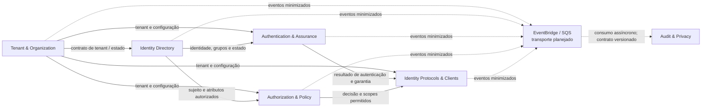

# Domínios e bounded contexts

## Objetivo e escopo

Esta proposta organiza o domínio de IAM para uma plataforma corporativa
multi-tenant. É um modelo estratégico inicial baseado nas histórias em
[`4dev/user_stories/initial-scope.md`](../../4dev/user_stories/initial-scope.md)
e no baseline de
[`4dev/security/baseline.md`](../../4dev/security/baseline.md). Os termos,
fronteiras e fluxos precisam ser validados com responsáveis de produto,
segurança, privacidade e operações antes de se tornarem contratos definitivos.

Bounded contexts são limites de modelo e linguagem, não necessariamente
processos, repositórios ou deploys separados. Dados pessoais devem ter
finalidade, acesso, retenção e descarte definidos; todos os fluxos devem
preservar o tenant autenticado e autorizado no servidor.

## Classificação de domínios

| Categoria | Domínio | Justificativa |
|---|---|---|
| **Core** | Autenticação e garantia de identidade | Valida credenciais e fatores, conduz desafios e determina o nível de garantia da sessão. Segurança e experiência de autenticação diferenciam o produto. |
| **Core** | Autorização e políticas de acesso | Modela RBAC/ABAC e toma decisões de acesso tenant-aware com negação por padrão. A correção e a explicabilidade das decisões são centrais ao produto. |
| **Supporting** | Tenant e organização | Gerencia organizações, configuração e estado do tenant; fornece o limite de isolamento para os demais domínios. |
| **Supporting** | Diretório de identidades | Mantém o ciclo de vida e os atributos de identidades e grupos. Não autentica nem decide permissões. |
| **Supporting** | Protocolos de identidade e clientes | Expõe os contratos OAuth2/OIDC e gerencia clientes registrados; traduz contratos externos para os modelos internos. Conformidade com padrões é necessária, mas não substitui as políticas core. |
| **Supporting** | Auditoria e privacidade | Mantém evidências de ações relevantes e suporta investigação, retenção e atendimento a obrigações de privacidade. |
| **Generic** | Chaves, criptografia e segredos | Capacidade de infraestrutura baseada em serviços gerenciados, como AWS KMS e Secrets Manager; não deve reinventar criptografia ou armazenamento de segredos. |
| **Generic** | Mensageria e entrega de notificações | Transporte assíncrono e entrega por provedores substituíveis. Adaptadores não devem incorporar regras de autorização ou autenticação. |
| **Generic** | Observabilidade | Métricas, logs e traces correlacionáveis usando OpenTelemetry e os serviços operacionais escolhidos. Telemetria não é registro de auditoria. |

Uma capacidade genérica pode ser fornecida por serviço AWS ou biblioteca, sem se
tornar um bounded context interno. Domínios de terceiros permanecem atrás de
adaptadores e contratos explícitos.

## Bounded contexts

| Contexto | Classificação | Responsabilidade e linguagem ubíqua | Dados sob sua autoridade |
|---|---|---|---|
| **Tenant & Organization** | Supporting | Criar, configurar, suspender e encerrar organizações; `Tenant`, `TenantStatus`, configuração e quotas. | Identificador, estado e configuração do tenant. Não possui identidades de usuário. |
| **Identity Directory** | Supporting | Cadastrar e manter identidades, grupos e atributos de perfil; `Identity`, `Group`, `IdentityStatus`. | Identificadores e atributos de identidade/grupo dentro do tenant. Não guarda segredos de autenticação nem define permissões. |
| **Authentication & Assurance** | Core | Verificar autenticadores, conduzir MFA e recuperação, aplicar controles de tentativa e estabelecer resultado/garantia; `Authenticator`, `Challenge`, `AuthenticationResult`, `AssuranceLevel`. | Material de verificação protegido, vínculo de fatores e estado dos desafios. Segredos nunca são publicados em eventos ou logs. |
| **Authorization & Policy** | Core | Administrar papéis, políticas RBAC/ABAC e avaliar acesso; `Subject`, `Resource`, `Action`, `Policy`, `Decision`. | Políticas, vínculos de papel e decisões próprias. A avaliação usa tenant e sujeito confiáveis e nega por padrão. |
| **Identity Protocols & Clients** | Supporting | Implementar contratos HTTP OAuth2/OIDC, registrar clientes, traduzir scopes/claims e coordenar autorização e autenticação; `OAuthClient`, `RedirectURI`, `Scope`, `AuthorizationCode`, `Token`. | Registro e estado dos clientes, grants/códigos de curta duração e metadados necessários ao protocolo. Tokens e códigos não são transportados em eventos de domínio. |
| **Audit & Privacy** | Supporting | Registrar evidências de ações administrativas e de segurança; apoiar consulta autorizada, retenção, minimização e descarte; `AuditRecord`, `RetentionPolicy`, `DataSubjectRequest`. | Registros de auditoria e controles de retenção. Integridade, acesso restrito e política de imutabilidade ainda exigem decisão arquitetural específica. |

### Invariantes entre contextos

- A identidade de tenant é extraída de contexto validado no servidor; um
  `tenant_id` fornecido isoladamente pelo cliente nunca autoriza acesso.
- Um identificador de identidade não substitui o estado de elegibilidade para
  autenticação. Suspensão/encerramento deve produzir comportamento definido e
  consistente nos contextos consumidores.
- Autenticação responde quem demonstrou controle de fatores e com qual nível
  de garantia; autorização responde se o sujeito pode executar uma ação sobre
  um recurso naquele tenant. Uma não implica a outra.
- O contexto de protocolos não deve implementar políticas de domínio
  paralelas: delega autenticação e autorização aos respectivos contextos e
  aplica apenas as regras de tradução do protocolo.
- Eventos e telemetria contêm o mínimo necessário. Senhas, segredos de fatores,
  tokens, códigos de autorização, chaves privadas e claims completos não devem
  ser emitidos ou registrados.

## Context map

As setas contínuas representam consultas/contratos necessários ao fluxo
síncrono; não especificam protocolo de rede nem obrigam deploys separados.
Eventos para auditoria são uma integração assíncrona planejada. A estratégia de
persistência/outbox, ordenação, repetição, retenção e falha de entrega deve ser
fechada antes da implementação.

| Consumidor | Fornecedor | Relação proposta | Contrato / proteção |
|---|---|---|---|
| Identity Directory | Tenant & Organization | Customer–Supplier; diretório consome o contrato publicado de tenant. | Identificador imutável e estado; nunca confiar em tenant informado sem validação. |
| Authentication & Assurance | Identity Directory | Customer–Supplier; autenticação consulta o estado mínimo da identidade. | Contrato publicado com estado e identificador; falha ou indisponibilidade não pode transformar-se em autenticação permitida. |
| Authorization & Policy | Identity Directory | Customer–Supplier; autorização consome sujeito/grupos/atributos autorizados. | Vocabulário explícito de atributos; evitar cópia indiscriminada de PII. |
| Authentication & Assurance / Authorization & Policy | Tenant & Organization | Customer–Supplier para escopo, estado e configuração do tenant. | Toda decisão é limitada pelo tenant autenticado e pelo estado aplicável. |
| Identity Protocols & Clients | Authentication & Assurance | Customer–Supplier; o protocolo coordena a autenticação. | Resultado tipado e nível de garantia; não expor credenciais ou material de fator. |
| Identity Protocols & Clients | Authorization & Policy | Customer–Supplier; o protocolo solicita decisão de acesso. | Decisão, scopes e contexto mínimos; negação por padrão. |
| Audit & Privacy | Contextos de negócio | Publicação/assinatura de eventos de integração. | Envelope versionado, dados minimizados, acesso restrito e consumidor idempotente. |

Se um contexto externo fornecer um modelo incompatível, introduzir ACL
(anti-corruption layer) no adaptador de integração. Não propagar modelos de
provedores ou formatos de persistência entre bounded contexts.

## Mapa de serviços

O mapa de serviços é lógico. A recomendação inicial é um **monólito modular**
em `identity_service`, com módulos que respeitem os bounded contexts e
interfaces explícitas. A estrutura atual do código é apenas o scaffold de
camadas e ainda não materializa estes contextos.

| Serviço lógico / componente | Limite e responsabilidade | Interfaces e dependências planejadas |
|---|---|---|
| **Identity API** | Entrada síncrona para APIs administrativas e fluxos OAuth2/OIDC; contém módulos de Tenant, Directory, Authentication, Authorization e Protocols. | FastAPI/Pydantic; portas de aplicação; PostgreSQL por adaptadores SQLAlchemy; Redis apenas para casos de uso de curta duração/cache com isolamento de tenant. |
| **Event publisher / outbox relay** | Publica eventos de integração após persistência bem-sucedida, sem perder consistência entre estado e mensagem. Pode iniciar como processo/worker no mesmo deploy. | Outbox transacional e adaptador EventBridge; SQS para filas/consumidores conforme necessidade. Persistência, retries e DLQ precisam de ADR. |
| **Audit consumer** | Consome eventos permitidos, valida versão e tenant, deduplica e persiste evidências segundo política de retenção. | SQS/EventBridge planejados; armazenamento de auditoria ainda por decidir. Não tratar logs comuns como prova de auditoria. |
| **Notification adapter/worker** | Envia comunicações de segurança necessárias sem decidir autenticação ou acesso. | Adaptadores para provedores externos; conteúdo e canal sujeitos a política de privacidade. |
| **Plataforma AWS** | Serviços gerenciados de dados, chaves, segredos, mensageria e observabilidade. | PostgreSQL, Redis, KMS/Secrets Manager, EventBridge, SQS, CloudWatch e X-Ray; limites de IAM com menor privilégio. |

Chamadas de autenticação, emissão/validação de protocolo e decisões de
autorização permanecem síncronas quando o resultado é necessário para responder
ao cliente. Eventos são para efeitos posteriores e integração, nunca para
substituir uma decisão de acesso em tempo real. Emissão de tokens deve depender
de validações vigentes de cliente, tenant, sujeito, redirect URI, scopes,
expiração e políticas aplicáveis.

Extraia um contexto para serviço independente somente quando houver motivo
verificado (isolamento de segurança, escala, disponibilidade, cadência de
mudança ou ownership) e contratos/observabilidade suficientes. Uma extração
não deve relaxar isolamento tenant-aware, autorização nem auditoria.

## Decisões em aberto

- Semântica de tenant, hierarquia organizacional, domínios de identidade e
  identidade federada.
- Flows OAuth2/OIDC suportados, modelo de clientes/confidencialidade,
  federação, revogação e ciclo de vida de chaves de assinatura.
- Papéis, atributos, precedência, versionamento e explicabilidade das políticas
  RBAC/ABAC.
- Autenticadores/MFA, recuperação de conta, limites antiabuso e níveis de
  garantia.
- Armazenamento append-only, retenção, consulta e acesso a auditoria; base
  legal, minimização e processos LGPD.
- Consistência entre PostgreSQL e eventos, deduplicação, ordenação, retries,
  DLQ, replay e resposta a indisponibilidade dos consumidores.

Cada decisão que fechar contratos, persistência, fluxos de segurança ou
infraestrutura deve ser registrada em ADR próprio e coberta por requisitos,
modelo de ameaça e testes.
